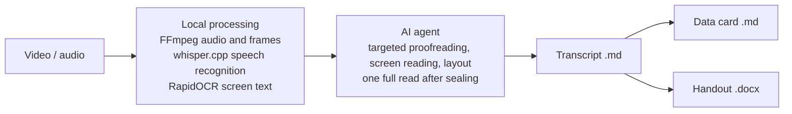
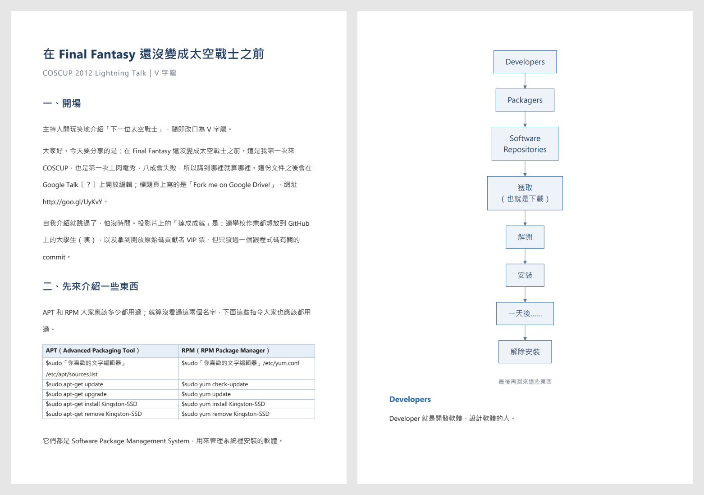

[繁體中文](README.md) | **English**

# Video Transcript & Handout Workflow

Video Transcript & Handout Workflow (影片轉逐字稿與講義) is a Windows toolkit that turns Chinese lecture videos into complete Traditional Chinese transcripts, then into AI-readable data cards and phone-friendly DOCX handouts. Speech recognition, frame sampling and OCR run locally; an AI agent proofreads, reads the screen content and lays out the result under fixed rules. Anything that cannot be heard or read clearly is marked 〔？〕 instead of guessed.

| Item | Details |
| --- | --- |
| Purpose | Chinese lecture videos → transcript, data card, handout |
| Platform | Windows 11 (Windows 10 untested), Windows PowerShell 5.1 |
| Hardware | NVIDIA GPU recommended; without one the CPU is used automatically, more slowly |
| Speech recognition | whisper.cpp b4938 with the large-v3-turbo (q5_0) model |
| Screen text | Scene-change plus fixed-interval frame sampling, RapidOCR on CPU |
| Output | Transcript `.md`, data card `.md`, handout `.docx` |
| How you use it | Open an AI agent in the project folder and ask in plain language |
| AI agent | Any model with tool calling and image understanding; tested with Claude Code and Codex |
| Install scope | Python, packages, tools and models all live in the project's `.runtime/`; a few system components are listed under [System components and installation](#system-components-and-installation) |

AI agents: start with [AGENTS.md](AGENTS.md). The project rules, skills and docs are written in Traditional Chinese.

## What it produces

- **Transcript** — every spoken word, not summarized or rewritten, with on-screen text, tables and diagrams inserted where they appear. The result is a single self-contained Traditional Chinese Markdown file.
- **Data card** — built from a finished transcript. Keeps the transcript text verbatim and adds a table of contents, representative quotes per section, terms, cases and screen structure, for AI retrieval. Several videos in a series can be combined into one series card.
- **Handout** — watching a video means going at the speaker's pace; reading is much faster. The handout condenses a video into something you can read through: built from a finished transcript, rewritten into written style, organized into chapters in lecture order, with tables and Mermaid diagrams, exported as a DOCX designed for reading on a phone.

## How it works



Local programs do all deterministic work: extracting audio and frames, speech recognition, OCR, comparison, validation and assembling the outputs. The AI agent mainly works on the flagged passages and frames the programs prepare, then reads the sealed final candidate once in full. Every proofreading and layout decision is validated by the programs, which reject non-compliant changes such as missing or duplicated passages, broken order, or references to evidence that does not exist.

All rules live in [AGENTS.md](AGENTS.md) and the skill documents, and every operation goes through `run.ps1`, so the workflow is not tied to a specific AI service or agent harness.

## Requirements

- Windows 11. Windows 10 is untested. Setup uses only what Windows ships with (Windows PowerShell 5.1, curl and tar); no PowerShell 7, and no change to the system language or the PowerShell execution policy.
- Disk space: about 2.5 GB for the environment and about 1 GB of download cache, plus room for videos and per-video evidence (audio, frames).
- Internet access for the first setup, which downloads about 1.5 GB.
- An AI agent that can call tools (run commands, read and write files) and understand images.
- The system components in the next section.

## System components and installation

These components have to be installed on the system and cannot live inside the project folder. The `system` field of `.\run.ps1 doctor` reports whether each one is ready. The AI agent checks them on first launch and tells you what is missing. You can install them yourself, or let the agent run the commands below for you; it will ask for your approval with a request code first.

| Component | Used for | Need | How to install |
| --- | --- | --- | --- |
| Microsoft Visual C++ 2015–2022 Redistributable (x64) | Running whisper.cpp | Required | `winget install --id Microsoft.VCRedist.2015+.x64 -e`, or run the [official Microsoft installer](https://aka.ms/vs/17/release/vc_redist.x64.exe). Requires administrator rights. |
| NVIDIA display driver (CUDA 11.8 or later) | GPU speech recognition | Recommended; otherwise the CPU is used automatically | No winget package. Install from [NVIDIA driver downloads](https://www.nvidia.com/Download/index.aspx) or the NVIDIA App for your GPU model. The agent can identify the model with `nvidia-smi` or `Get-CimInstance Win32_VideoController` and open the download page; the installer needs administrator rights and may require a restart. |
| Microsoft Edge or Google Chrome | Rendering Mermaid diagrams in handouts | Required for handouts | Edge ships with Windows 11. If missing: `winget install --id Microsoft.Edge -e` or `winget install --id Google.Chrome -e`. |
| Microsoft Word | Handout preview (PDF export) | Optional; the preview is skipped without it | Needs a Microsoft 365 / Office license; the agent does not install it. |

The CUDA libraries that GPU speech recognition needs (cuBLAS) are downloaded into the project by setup; the CUDA Toolkit is not required.

## Installation

Open PowerShell in the project root:

```powershell
.\run.ps1 setup           # transcription: Python 3.12.12, packages, whisper.cpp, cuBLAS, model, FFmpeg
.\run.ps1 setup-publish   # data cards and handouts: python-docx, Playwright, Mermaid
.\run.ps1 doctor          # check the transcription environment and system components
.\run.ps1 publish-doctor  # check the data card and handout environment
```

The first command of any kind installs the project's own uv and Python into `.runtime/` (about 50 MB). If PowerShell says running scripts is disabled, or you are in cmd or Git Bash, use `.\run.cmd` instead of `.\run.ps1` with the same arguments.

Every download is pinned by version and SHA-256; a mismatch stops setup instead of falling back to another version. Downloads go through Windows' own connection stack first (curl, PowerShell) and only then through Python, so Python's certificate list does not matter. An interrupted setup resumes when you run the same command again; the full output is kept in `.runtime/logs/`. With a complete cache, `.\run.ps1 setup --offline` rebuilds without network access. Setup also creates the `工作資料/` (working data) folder structure.

You can also skip running these yourself: open an AI agent in the project folder and it will state the download size, then run setup and doctor for you.

## Getting started

1. Put a video in `工作資料/原檔/` (source files).
2. Open an AI agent (for example Claude Code or Codex) in the project folder.
3. Ask in plain language, for example:
   - "Transcribe 工作資料/原檔/lesson1.mp4"
   - "Make a data card for lesson1"
   - "Turn lesson1 into a handout"
4. Results appear under `工作資料/輸出/` (outputs), named after the source video:

| Output | Location |
| --- | --- |
| Transcript | `工作資料/輸出/逐字稿/<video name>.md` |
| Data card | `工作資料/輸出/資料卡/<video name>.md` |
| Handout | `工作資料/輸出/講義/<video name>.docx` |

To see how far each video has progressed, run `.\run.ps1 catalog`.

## Worked example

All three workflows were run on a Creative Commons video: the COSCUP 2012 lightning talk "在 Final Fantasy 還沒變成 太空戰士 以前" (Before Final Fantasy became 太空戰士) by V字龍, 5 minutes 6 seconds long, licensed [CC BY-SA 3.0 Taiwan](https://creativecommons.org/licenses/by-sa/3.0/tw/). The full outputs and license notes are in [examples/](examples/README.md).

| Stage | Result |
| --- | --- |
| Local processing | Speech recognition in 13 seconds (GPU: RTX 3070, 8 GB); 180 frames extracted, OCR in about 2 min 15 s (CPU) |
| Transcript | 40 sections and 39 screen cards; 3 unclear words marked 〔？〕 |
| Data card | 7 sections with a table of contents, a representative sentence per section, keywords and a list of words to verify |
| Handout | 8 chapters on 13 DOCX pages, with 10 screenshots and 1 Mermaid flowchart |

Transcript excerpt. Slide text is placed where the speaker talks about it, and anything unreadable is noted under 畫面註 (screen note) instead of guessed:

```markdown
## 先來介紹一些東西：APT 與 RPM

> **畫面補充：先來介紹一些東西：APT 與 RPM**
>
> 先來介紹一些東西……  
> First, introduce some things...  
> APT  
> Advanced Packaging Tool  
> `$sudo「你喜歡的文字編輯器」/etc/apt/sources.list`  
> `$sudo apt-get update`  
> …
>
> 畫面註：指令字很小，「你喜歡的文字編輯器」為最佳判讀，RPM 那行尤其模糊；$ 與 sudo 之間是否有空格無法確認

好，我們先來介紹一些東西，那APT、RPM大家應該多少都會用過，如果還沒看過的話，那這些指令大家都應該用過了。然後這個東西是……
```

Data card excerpt. The front matter tells an AI the source, keywords and open questions without reading the whole card:

```yaml
title: '[COSCUP 2012] Lightning Talk - 在 Final Fantasy 還沒變成 太空戰士 以前 - V字龍'
doc_type: video_datacard
source:
  video: '[COSCUP 2012] Lightning Talk - 在 Final Fantasy 還沒變成 太空戰士 以前 - V字龍.mp4'
  duration: 05:06
keywords:
- Final Fantasy
- 太空戰士
- APT
- RPM
unresolved:
- 節: S01
  原文: 然後這一個文件之後會開放編輯在Google Talk上面〔？〕。
```

Handout pages 1 and 6:



A sample conversation (translated). Before changing the primary transcript, the agent files a request and acts only after you reply with its code:

```text
You:   Transcribe the COSCUP video in 工作資料/原檔
Agent: Local processing done: speech recognition took 13 seconds, OCR ran on 180 frames. Now checking the flagged spots and the slides.
Agent: The transcript is ready in 工作資料/輸出/逐字稿/. Three unclear words are marked 〔？〕.
You:   In the 授權條款 (license) part, "Google Talk〔？〕" should be Google Drive; it's on the title slide
Agent: The title slide does read "Fork me on Google Drive!".
       【變更申請 R4X9】 (change request)
       Target: 工作資料/輸出/逐字稿/[COSCUP 2012] Lightning Talk - … - V字龍.md
       Action: modify
       Changes:
       1. Google Talk〔？〕 → Google Drive (授權條款 part)
       Will lose: nothing
       To approve, reply: 同意 R4X9
You:   同意 R4X9
Agent: Saved the current version first; the change is done.
You:   Now make a data card and a handout
Agent: Done: the data card is in 工作資料/輸出/資料卡/ and the handout in 工作資料/輸出/講義/.
```

## The three workflows

### Transcription

- **Purpose**: turn a video or audio file into a transcript, including proofreading and screen transcription.
- **Input**: a video or audio file in `工作資料/原檔/`.
- **Output**: `工作資料/輸出/逐字稿/<video name>.md` (the primary transcript). Intermediate files (raw and corrected TXT, SRT and MD, plus screen transcription with frame links) stay in `工作資料/任務/轉錄/<run_id>/exports/`.
- **Process**: local speech recognition, frame sampling and OCR, with doubtful passages flagged by the programs. The agent checks evidence for each flag, transcribes the screen, lays out the text, seals the final candidate, reads it once in full, and fixes the remaining issues in a single batch.
- **Rules** (Chinese): [transcription skill](system/skills/video-transcribe/SKILL.md), [single-pass review](system/docs/final-review.md), [delivery contract](system/docs/review-contract.md), [local evidence](system/docs/local-evidence.md)

### Data card

- **Purpose**: Markdown for AI readers that keeps the transcript text and adds structure.
- **Input**: a finished transcription; several can be combined into a series card.
- **Output**: `工作資料/輸出/資料卡/<video name>.md`.
- **Process**: `datacard prepare` writes a compact input package, the agent reads it once and writes a plan, and `datacard build` validates and assembles the card. The text is copied from the transcript by the program; summaries, terms and case quotes must be verbatim, or the build is rejected.
- **Rules** (Chinese): [data card skill](system/skills/datacard/SKILL.md)

### Handout

- **Purpose**: take in the same content in far less time than watching the video. A video runs at the speaker's pace, fillers, restarts and pauses included; text lets you set your own speed and skip what you already know. So the handout puts readability first: speech becomes written style without fillers, repeats or restarts, on-screen tables and flows become tables and diagrams, only frames with content are kept, and it is laid out for phones. Every point, example, number and name the speaker gave is kept, and nothing the speaker did not say is added.
- **Input**: a finished transcription.
- **Output**: `工作資料/輸出/講義/<video name>.docx`.
- **Process**: `handout prepare` writes an input package, the agent rewrites the content as a handout draft, and `handout build` checks paragraph coverage and that numbers and proper nouns are preserved before exporting the DOCX. Fonts, colors and diagram styling come from a theme; switching themes only needs another build.
- **Rules** (Chinese): [handout skill](system/skills/handout/SKILL.md); themes in [system/config/handout-themes](system/config/handout-themes)

### Domain modules

A domain module lets the programs validate specialist content. The built-in example is a BaZi (Chinese astrology) module, `bazi`, which checks that four-pillar stem-branch pairs are valid and actually appear in the source, and protects those characters from simplified/traditional conversion. Modules live in [system/src/domains](system/src/domains).

## Design principles

- **No guessing** — anything unclear is marked 〔？〕, never filled in from context or general knowledge.
- **Speech is not rewritten** — the transcript keeps every spoken word; data card text and quotes are copied from the transcript and checked by the program.
- **Sources are never overwritten** — source files, recognition results, OCR and frames are kept as-is; corrections are stored separately with their evidence.
- **One full read** — the agent finishes all targeted checks first, seals the final candidate, reads it once in full, and fixes what remains in one batch, instead of rereading the whole text again and again.
- **Important actions need your approval** — before changing the primary transcript, overwriting, restoring or deleting a finished output, or installing a system component, the agent lists what it will do with a 4-character request code. It proceeds only when you reply "同意 <code>" ("approve <code>"); "OK" or "yes" does not count.
- **Your edits win** — editing the primary transcript yourself is a legitimate change; the system detects it and keeps every version.
- **Self-contained** — anything that can run from the project folder is downloaded into `.runtime/` by setup; system components are installed only with your approval.

## Glossary

| Term | Meaning |
| --- | --- |
| AI agent | A model with tool calling and image understanding working in the project folder, such as Claude Code or Codex |
| Primary transcript (主稿) | The final transcript, the Markdown file in `工作資料/輸出/逐字稿/` |
| run | One transcription task, stored in `工作資料/任務/轉錄/<run_id>/` with all evidence for that video |
| Screen card (畫面卡) | A transcription of one piece of screen content, such as a slide, table or diagram |
| 〔？〕 | A word that could not be confirmed; the marker is kept instead of a guess |
| Data card (資料卡) | Markdown for AI readers, built around the transcript text |
| Handout (講義) | DOCX for human readers, rewritten from the transcript |

## Folder layout

```text
AGENTS.md            Entry point and rules for AI agents (CLAUDE.md imports the same file)
run.ps1              Single entry point for every command
run.cmd              Same entry point for cmd, Git Bash, or PowerShell with scripts disabled
examples/            Worked-example outputs and their license notes
system/              Programs, rules, settings and tests (tracked by Git)
  skills/              Rules for the three workflows
  src/                 Python code
  bootstrap/           Setup and check scripts
  config/              Settings, term lists, version locks
  docs/                Delivery contract and maintenance notes
  tests/               Tests
.runtime/            Installed content: Python, venvs, tools, models, cache (not in Git)
工作資料/             Your videos, evidence and outputs (not in Git)
  原檔/                Videos to process
  任務/                Evidence for each task
  輸出/                Transcripts, data cards, handouts
  索引/                Work index (catalog)
```

## Common commands

The agent runs whatever it needs; these are the commands you are most likely to use directly.

```powershell
.\run.ps1 catalog                    # status of transcript, data card and handout per video
.\run.ps1 catalog <keyword>          # search titles and output text (simplified or traditional)
.\run.ps1 catalog --show <video>     # tasks, output versions and history of one video
.\run.ps1 list-runs                  # list transcription tasks
.\run.ps1 status <run_dir>           # re-check whether a transcription task is complete
.\run.ps1 process <video path>       # local processing only (speech recognition, frames, OCR)
.\run.ps1 process <video path> --device cpu   # force the CPU (chosen automatically by default)
.\run.ps1 doctor                     # check the environment and system components
.\run.ps1 test                       # run the tests
```

## FAQ

**Which AI can I use?**
It is tested with Claude Code and Codex. In principle any model and agent harness with tool calling (running commands, reading and writing files) and image understanding works: the rules are in AGENTS.md and every operation goes through `run.ps1`. If the harness provides no session ID, the agent passes a stable `--task-id`.

**Does it work without an NVIDIA GPU?**
Yes. Without a supported NVIDIA GPU, speech recognition switches to the CPU automatically; nothing needs to be set. Speed depends on the processor: on a 12-thread CPU it takes about as long as the video itself, roughly 20 times slower than the GPU. OCR always runs on the CPU.

**Is my video uploaded anywhere?**
Speech recognition, frame sampling and OCR run locally, and the video itself is not uploaded. The flagged passages, frames and the one full read that the agent works with are sent to whichever AI service you use.

**Can I use it without an AI agent?**
You can run `.\run.ps1 process <video path>` on its own to get the raw local transcript (TXT, SRT, MD in the task's `exports/transcripts/`). Proofreading, screen transcription, the primary transcript, data cards and handouts need an agent.

**Does it support languages other than Chinese?**
The default language is Chinese (`zh`), and the traditional-character conversion and proofreading rules are designed for Chinese. `--language` can set another language for speech recognition, but the rest of the workflow is neither designed nor tested for it.

**Can I edit the transcript myself?**
Yes. Edit the primary transcript in `工作資料/輸出/逐字稿/` directly. The system accepts your edits, `status` reports them, and every version is kept in the task folder. Under the project rules, the agent must get your approval with a request code before overwriting it.

**Why does the agent ask me for a request code?**
Changing the transcript, overwriting or deleting outputs, and installing system components can lose content or change your computer. The code ties your approval to the one request in front of you, so an earlier approval is never applied to a new action.

**How is this different from a typical speech-to-subtitle tool?**
A typical tool stops at the speech recognition output. This toolkit also transcribes on-screen text, tables and diagrams, has an AI agent proofread against evidence, keeps 〔？〕 markers with records where things stay uncertain, and then derives data cards and handouts.

## Third-party components

Setup downloads these from their official release locations; they are not included in this repository. Versions and hashes are pinned in `system/config/`.

| Component | Version | License |
| --- | --- | --- |
| [FFmpeg](https://ffmpeg.org/) ([gyan.dev](https://www.gyan.dev/ffmpeg/builds/) essentials build) | 7.1.1 | GPL-3.0 |
| [whisper.cpp](https://github.com/ggml-org/whisper.cpp) | b4938 (CUDA 11.8) | MIT |
| [NVIDIA cuBLAS](https://developer.nvidia.com/cublas) (CUDA 11.8 redistributable) | 11.11.3.6 | NVIDIA CUDA Toolkit EULA |
| [Whisper](https://github.com/openai/whisper) large-v3-turbo (ggml q5_0) | — | MIT |
| [uv](https://github.com/astral-sh/uv) | 0.12.13 | MIT / Apache-2.0 |
| [Mermaid](https://github.com/mermaid-js/mermaid) | 11.17.2 | MIT |

Python package versions are pinned in [requirements.lock.txt](system/config/requirements.lock.txt) and [publish-requirements.lock.txt](system/config/publish-requirements.lock.txt), under each package's own license.

## License

The code and documentation are released under the [MIT License](LICENSE). The outputs in `examples/` are adapted from a Creative Commons video and released under CC BY-SA 3.0 Taiwan; see [examples/README.md](examples/README.md). Third-party components downloaded by setup keep their own licenses, listed in the table above.

## Maintenance

Run `.\run.ps1 test` after changing code. Folder, build and cleanup rules are in [workspace maintenance](system/docs/workspace.md) (Chinese). The Chinese and English READMEs are updated together in the same change.
