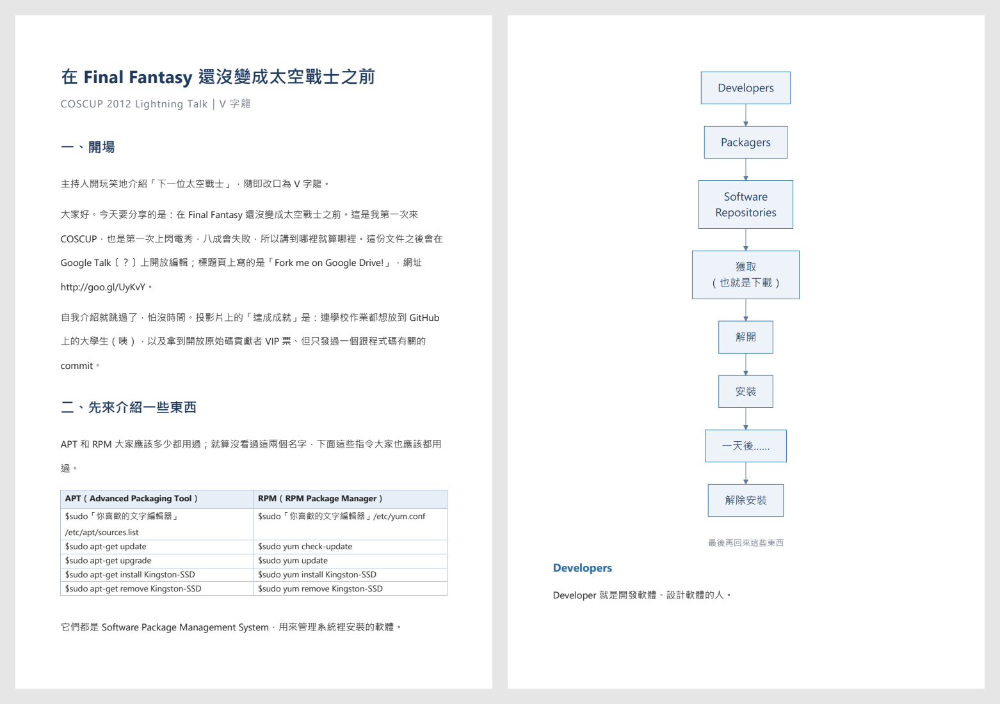
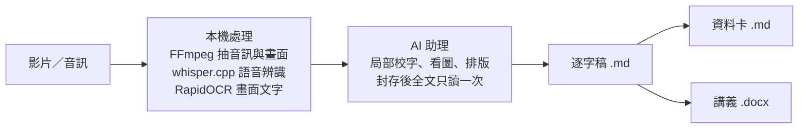

<div align="center">

# AI Video Transcriber

**影片轉逐字稿與講義**

在 Windows 本機把中文教學影片變成完整逐字稿、AI 資料卡與手機講義

[](#-快速開始)
[](system/config/bootstrap-lock.json)
[](https://github.com/ggml-org/whisper.cpp)
[](AGENTS.md)
[](LICENSE)

**繁體中文** · [English](README.en.md)

[快速問答](#-快速問答) · [成品長這樣](#-成品長這樣) · [快速開始](#-快速開始) · [常見問題](#-常見問題)

</div>

**AI Video Transcriber（影片轉逐字稿與講義）** 是一套在 Windows 本機執行的開源工具，把中文教學影片、課程錄影與講座轉成三種成品：保留全部口述的繁體中文逐字稿、給 AI 讀的資料卡，以及在手機上好讀的 DOCX 講義。語音轉文字（whisper.cpp，Whisper large-v3-turbo 模型）、抽圖與投影片 OCR 都在本機完成；校字、看圖與排版由 Claude Code、Codex 等 AI 助理依固定規範接手。聽不清或看不清的字標成〔？〕，不補猜。

> [!NOTE]
> 如果你是 AI 助理，請從 [AGENTS.md](AGENTS.md) 開始，並照裡面的規則執行。

## 💡 快速問答

- **這是什麼？** — 把中文教學影片轉成文字的工具。成品有三種：完整逐字稿、給 AI 讀的資料卡、給人讀的手機講義。（[成品長這樣](#-成品長這樣)）
- **要錢嗎？影片會上傳嗎？** — 免費開源（MIT）。語音辨識、抽圖與 OCR 都在本機執行，影片不上傳；只有校字時的疑點片段、截圖與一次全文閱讀會送到你使用的 AI 服務。
- **沒有顯卡能用嗎？** — 可以，沒有 NVIDIA 顯示卡時自動改用 CPU。在 12 執行緒的處理器上，處理時間約與影片等長，GPU 大約快 20 倍。
- **投影片上的字也會轉嗎？** — 會。程式在換景時抽圖並做 OCR，AI 助理再看圖轉錄文字、表格與流程圖，插在講者講到的位置。
- **辨識錯字怎麼處理？** — 程式標出疑點，AI 助理依前後文、重新辨識與畫面證據校正；證據不足時標〔？〕，不補猜。
- **要用哪個 AI？** — 已用 Claude Code 與 Codex 測試；其他能執行指令、讀寫檔案並看得懂圖的 AI 代理也可以。
- **怎麼開始？** — 安裝後把影片放進 `工作資料/原檔/`，在專案資料夾開啟 AI 助理，對它說「幫我轉錄這支影片」。（[快速開始](#-快速開始)）

## 📄 成品長這樣

以一支創用 CC 授權的影片實際跑完三條流程：COSCUP 2012 閃電秀〈在 Final Fantasy 還沒變成 太空戰士 以前〉，講者 V字龍，長 5 分 06 秒，授權為 [CC BY-SA 3.0 台灣](https://creativecommons.org/licenses/by-sa/3.0/tw/)。完整成品與授權說明在 [examples/](examples/README.md)。

| 階段 | 結果 |
| --- | --- |
| 本機處理 | 語音辨識 13 秒（GPU：RTX 3070 8 GB）；抽出 180 張畫面，抽圖與 OCR 約 2 分 15 秒（CPU），選裝 GPU 版 OCR 後約 48 秒 |
| 逐字稿 | 40 個小節、39 張畫面卡；3 處聽不清的字標成〔？〕 |
| 資料卡 | 7 節，含目錄、每節代表原句、關鍵字與待核對清單 |
| 講義 | 8 章、13 頁 DOCX，含 10 張畫面截圖與 1 張 Mermaid 流程圖 |

**講義**第 1 頁與第 6 頁：



**逐字稿**節錄。投影片文字插在講到的位置，看不清的地方寫在「畫面註」：

```markdown
## 標題頁

> **畫面補充：標題頁**
>
> 在 Final Fantasy 還沒變成 太空戰士 之前……  
> Fork me on Google Drive!  
> `http://goo.gl/UyKvY`  
> V字龍 | Vdragon  
> …
> COSCUP 2012 Lightning Talk
>
> 畫面註：右下角一直被講者子母畫面遮住，無法確認該處是否另有文字

我今天要分享的是在太空戰士……欸，Final Fantasy 還沒變成太空戰士。然後我是第一次來COSCUP。
```

**資料卡**節錄。開頭的欄位讓 AI 不必讀全文就知道來源、關鍵字與待核對的地方：

```yaml
title: '[COSCUP 2012] Lightning Talk - 在 Final Fantasy 還沒變成 太空戰士 以前 - V字龍'
doc_type: video_datacard
source:
  video: '[COSCUP 2012] Lightning Talk - 在 Final Fantasy 還沒變成 太空戰士 以前 - V字龍.mp4'
  duration: 05:06
keywords:
- Final Fantasy
- 太空戰士
- APT
- RPM
unresolved:
- 節: S01
  畫面: 標題頁
  疑點: 右下角一直被講者子母畫面遮住，無法確認該處是否另有文字
- 節: S01
  原文: 然後這一個文件之後會開放編輯在Google Talk上面〔？〕。
```

<details>
<summary>對話示意：AI 助理要改主稿前，會先提出申請</summary>

```text
你：幫我轉錄 工作資料/原檔 裡那支 COSCUP 的影片
AI：本機處理完成：語音辨識 13 秒，抽出 180 張畫面做 OCR。接著核對疑點與投影片。
AI：逐字稿完成，在 工作資料/輸出/逐字稿/。有 3 處聽不清，標成〔？〕。
你：「授權條款」那段的 Google Talk〔？〕應該是 Google Drive，標題頁上有寫
AI：標題頁確實寫著「Fork me on Google Drive!」。
    【變更申請 R4X9】
    對象：工作資料/輸出/逐字稿/[COSCUP 2012] Lightning Talk - … - V字龍.md
    動作：修改
    內容：
    1. Google Talk〔？〕 → Google Drive（「授權條款」段）
    會失去：無
    同意請回覆：同意 R4X9
你：同意 R4X9
AI：已先保存目前版本，修改完成。
你：再做一份資料卡和講義
AI：資料卡與講義完成，在 工作資料/輸出/資料卡/ 與 工作資料/輸出/講義/。
```

</details>

## ⚖️ 和一般語音轉文字工具有什麼不同

| | 一般語音轉文字工具 | AI Video Transcriber |
| --- | --- | --- |
| 成品 | 字幕或純文字 | 逐字稿、資料卡、講義 |
| 投影片與畫面上的字 | 通常不處理 | 抽圖、OCR，再由 AI 助理看圖轉錄文字、表格與流程圖 |
| 辨識錯字 | 照辨識結果輸出 | 程式標出疑點，AI 助理依證據校正 |
| 聽不清的字 | 輸出模型猜的字 | 標成〔？〕並留下紀錄 |
| 影片在哪裡處理 | 依工具而定；雲端服務需上傳影片 | 語音與畫面都在本機處理 |
| 給 AI 再利用 | 需要自己整理 | 資料卡附分節、關鍵字與待核對清單 |

## 🎯 適合與不適合

**適合**

- 中文教學影片、線上課程、講座與研討會演講，尤其是有投影片的。
- 想用讀的代替看的：看影片得跟著講者的速度，讀講義可以快得多。
- 想把影片內容變成 AI 能檢索的知識來源。

**不適合**

- 即時字幕或直播。
- 需要分辨誰在說話的多人會議：不做講者分離。
- macOS、Linux：只支援 Windows（Windows 10 未測試）。
- 中文以外的語言：語音辨識可以指定，但後續流程沒有針對設計與測試。

## ⚙️ 運作方式



本機程式負責所有確定性的工作：抽音訊與畫面、語音辨識、OCR、比對、驗證與組裝成品。AI 助理主要看程式整理出的疑點片段與畫面，封存最終候選後再讀一次全文；校字與排版決定都交給程式驗證。程式拒絕不合規的修改，例如漏段、重複、順序錯亂或引用不存在的證據。

規則全部寫在 [AGENTS.md](AGENTS.md) 與各 skill 文件，所有操作都經過 `run.ps1`，因此不綁定特定的 AI 服務或代理環境。

## 🚀 快速開始

### 需求

- Windows 11。安裝只用 Windows 內建的 PowerShell 5.1、curl 與 tar，不需要另裝 PowerShell 7，也不需要調整系統語系或 PowerShell 執行原則。
- 磁碟空間：環境約 2.5 GB，下載快取約 1 GB；另需存放影片與每支影片的處理證據（音訊、截圖等）。
- 第一次安裝需要網路，下載量約 1.5 GB。
- 一個 AI 助理：能呼叫工具（執行指令、讀寫檔案）並具備影像辨識能力。
- 少數必須裝在系統上的元件，見下方[系統元件與安裝指引](#系統元件與安裝指引)。

### 安裝

在專案根目錄開啟 PowerShell：

```powershell
.\run.ps1 setup           # 轉錄環境：Python 3.12.12、套件、whisper.cpp、cuBLAS、模型、FFmpeg
.\run.ps1 setup-publish   # 資料卡與講義環境：python-docx、Playwright、Mermaid
.\run.ps1 doctor          # 檢查轉錄環境與系統元件
.\run.ps1 publish-doctor  # 檢查資料卡與講義環境
.\run.ps1 setup-gpu-ocr   # 選裝：NVIDIA 顯示卡用的 GPU 版畫面 OCR（約 1.9 GB）
```

偵測到支援 CUDA 13 的 NVIDIA 驅動時，setup 會詢問要不要加裝 GPU 版畫面 OCR，預設不裝。裝了以後抽圖與 OCR 約快 2 倍，辨識結果和 CPU 版相同；顯示卡無法使用時自動改回 CPU。`.\run.ps1 setup-gpu-ocr --remove` 可改回 CPU 版。

第一次執行任何命令時，`run.ps1` 會先把專案專用的 uv 與 Python 裝進 `.runtime/`（約 50 MB）。PowerShell 若顯示「已停用指令碼執行」，或你用的是 cmd、Git Bash，把 `.\run.ps1` 換成 `.\run.cmd`，參數相同。

所有下載都鎖定版本與 SHA-256；檔案不符就停止，不改用其他版本。下載先走 Windows 本身的連線（curl、PowerShell），最後才用 Python，所以不受 Python 憑證清單影響。setup 中斷時重跑同一個命令即可接續，完整輸出存在 `.runtime/logs/`。快取完整時可用 `.\run.ps1 setup --offline` 離線重建。setup 也會建立 `工作資料/` 的資料夾結構。

你也可以不自己執行：在專案資料夾開啟 AI 助理，它會先說明下載量，再替你執行 setup 與 doctor。

### 系統元件與安裝指引

下列元件必須安裝在系統上，無法放進專案資料夾。`.\run.ps1 doctor` 的 `system` 欄位會回報它們是否就緒。AI 助理第一次啟動時會檢查，缺少時告訴你；你可以自己安裝，也可以讓 AI 助理代為執行下表的安裝指令，只需要回覆它提出的申請碼表示同意。

| 元件 | 用途 | 必要性 | 安裝方式 |
| --- | --- | --- | --- |
| Microsoft Visual C++ 2015–2022 可轉散發套件（x64） | whisper.cpp 執行需要 | 必要 | `winget install --id Microsoft.VCRedist.2015+.x64 -e`，或從 [Microsoft 官方](https://aka.ms/vs/17/release/vc_redist.x64.exe)下載執行。需要系統管理員權限。 |
| NVIDIA 顯示卡驅動（支援 CUDA 11.8 以上） | GPU 語音辨識；選裝的 GPU 版畫面 OCR 需支援 CUDA 13 | 建議；沒有時自動改用 CPU | 沒有 winget 套件。從 [NVIDIA 驅動下載](https://www.nvidia.com/Download/index.aspx)或 NVIDIA App 依顯示卡型號安裝。AI 助理可以用 `nvidia-smi` 或 `Get-CimInstance Win32_VideoController` 查出型號並開啟下載頁；安裝程式需要系統管理員權限，可能需要重新開機。 |
| Microsoft Edge 或 Google Chrome | 講義的 Mermaid 圖 | 製作講義時必要 | Windows 11 內建 Edge。缺少時：`winget install --id Microsoft.Edge -e` 或 `winget install --id Google.Chrome -e`。 |
| Microsoft Word | 講義預覽（轉 PDF） | 選用；沒有時只略過預覽 | 需要 Microsoft 365／Office 授權，AI 助理不代為安裝。 |

GPU 語音辨識需要的 CUDA 執行庫（cuBLAS）由 setup 下載到專案內，不需要安裝 CUDA Toolkit。

### 使用

1. 把影片放進 `工作資料/原檔/`。
2. 在專案資料夾開啟 AI 助理（例如 Claude Code 或 Codex）。
3. 用一般對話提出要求，例如：
   - 「幫我轉錄 工作資料/原檔/第一課.mp4」
   - 「第一課做一份資料卡」
   - 「第一課做成講義」
4. 成品出現在 `工作資料/輸出/` 的三個資料夾，檔名與原影片相同：

| 成品 | 位置 |
| --- | --- |
| 逐字稿 | `工作資料/輸出/逐字稿/<影片名>.md` |
| 資料卡 | `工作資料/輸出/資料卡/<影片名>.md` |
| 講義 | `工作資料/輸出/講義/<影片名>.docx` |

要查每支影片做到哪一步，執行 `.\run.ps1 catalog`。

## 🔄 三條工作流程

### 轉錄

- **用途**：影片或音訊轉成逐字稿，包含校字與畫面轉錄。
- **輸入**：`工作資料/原檔/` 裡的影片或音訊。
- **輸出**：`工作資料/輸出/逐字稿/<影片名>.md`（主稿）。中間檔（原始與校正後的 TXT、SRT、MD，含截圖連結的畫面轉錄）留在 `工作資料/任務/轉錄/<run_id>/exports/`。
- **過程**：本機完成語音辨識、抽圖與 OCR，程式標出疑點；AI 助理逐一取證校字、看圖轉錄畫面、排版，封存成最終候選後全文只讀一次，剩下的問題一次修正完畢交付。
- **規範**：[轉錄 skill](system/skills/video-transcribe/SKILL.md)、[一次成稿流程](system/docs/final-review.md)、[交付契約](system/docs/review-contract.md)、[本機證據流程](system/docs/local-evidence.md)

### 資料卡

- **用途**：給 AI 讀的 Markdown，保留主稿原文並加上結構。
- **輸入**：已完成的轉錄。可指定數支影片合成系列資料卡。
- **輸出**：`工作資料/輸出/資料卡/<影片名>.md`。
- **過程**：`datacard prepare` 產生精簡輸入包，AI 助理讀一次後寫出 plan，`datacard build` 由程式驗證並組裝。原文由程式從主稿複製；摘要、術語與案例引文必須逐字取自原文，對不上就退回。
- **規範**：[資料卡 skill](system/skills/datacard/SKILL.md)

### 講義

- **用途**：用比看完影片短得多的時間掌握同樣的內容。看影片得照講者的節奏，連口頭禪、重講與停頓都要一起聽完；讀字可以自己掌握速度，跳過已經懂的部分。因此講義以好讀為優先：口語改成書面語，去掉口頭禪、重複與改口，畫面上的表格與流程整理成表與圖，只放有內容的畫面，以手機閱讀為主。講者說過的觀點、例子、數字與專名都保留，不加講者沒說的內容。
- **輸入**：已完成的轉錄。
- **輸出**：`工作資料/輸出/講義/<影片名>.docx`。
- **過程**：`handout prepare` 產生輸入包，AI 助理改寫成書面語講義原稿，`handout build` 由程式檢查段落涵蓋、數字與專名保留，再輸出 DOCX。字型、配色與圖的外觀由主題決定，換主題只需重跑 build。
- **規範**：[講義 skill](system/skills/handout/SKILL.md)，主題在 [system/config/handout-themes](system/config/handout-themes)

### 領域模組

特定領域可用領域模組讓程式驗證專業內容。目前內建八字模組（`bazi`）作為範例：檢查四柱干支是否合法、是否確實出自原文，並保護干支用字不被繁簡轉換改掉。模組放在 [system/src/domains](system/src/domains)。

## 🧭 設計原則

- **不補猜**：聽不清、看不清的地方標成〔？〕，不用常識或上下文推測補上。
- **口述不改寫**：逐字稿保留全部口述；資料卡的原文與引句由程式從主稿複製並比對。
- **來源不覆寫**：原檔、語音辨識結果、OCR 與截圖都保留原樣，修正另存並記錄依據。
- **全文只讀一次**：AI 助理先做完所有局部取證，封存最終候選後只讀一次全文，剩下的問題一次修正，避免反覆重讀全文。
- **重要動作要你同意**：AI 助理要修改逐字稿主稿、覆蓋／還原／刪除已完成的成品，或安裝系統元件時，必須先列出內容並附上 4 碼申請碼；你回覆「同意 申請碼」才會執行。「好」「OK」都不算同意。
- **你的修改優先**：你直接編輯逐字稿主稿是合法的修改，系統會偵測並保存每個版本。
- **專案自帶**：能只在專案資料夾內使用的元件都由 setup 下載到 `.runtime/`；必須裝在系統上的元件只在你同意後才安裝。

## ❓ 常見問題

**可以用哪些 AI？**
測試環境是 Claude Code 與 Codex。理論上任何能呼叫工具（執行指令、讀寫檔案）並具備影像辨識能力的模型與代理環境都能使用：規則寫在 AGENTS.md，所有操作都透過 `run.ps1`。代理環境沒有提供 session ID 時，AI 助理需要用 `--task-id` 指定任務 ID。

**可以不用 AI 助理嗎？**
可以只執行 `.\run.ps1 process <影片路徑>`，取得本機語音辨識的原始逐字稿（TXT、SRT、MD，位於該任務的 `exports/transcripts/`）。校字、畫面轉錄、正式主稿、資料卡與講義都需要 AI 助理。

**支援中文以外的語言嗎？**
預設語言是中文（`zh`），繁體轉換與校字規範都是為中文設計。語音辨識可用 `--language` 指定其他語言，但後續流程沒有針對其他語言設計或測試。

**我可以自己修改逐字稿嗎？**
可以。直接編輯 `工作資料/輸出/逐字稿/` 裡的主稿即可。系統承認你的修改，`status` 會顯示偵測到的使用者修改，並在任務資料夾保存每個版本。依專案規則，AI 助理要覆蓋它之前，必須先取得你以申請碼表示的同意。

**為什麼 AI 助理會跟我要申請碼？**
修改主稿、覆蓋或刪除成品、安裝系統元件，都可能讓你失去內容或改變電腦設定。申請碼確保你的同意只對應眼前這一份列出內容的申請，舊的「同意」不會被套用到新的動作上。

**畫面 OCR 可以用 GPU 嗎？**
可以，但要另外選裝：NVIDIA 顯示卡、驅動支援 CUDA 13，再執行 `.\run.ps1 setup-gpu-ocr`（約 1.9 GB）。抽圖與 OCR 約快 2 倍，辨識結果相同。預設不裝，因為下載量大，而且語音辨識本來就用 GPU，OCR 只占本機處理的一部分。

**處理時會一直等嗎？**
`process` 一開始會依這台電腦過去的處理紀錄估計要多久，每完成一個階段再印一行。AI 助理照規則等在命令上，不會每幾秒查一次。

**語音辨識偶爾吐出半個字怎麼辦？**
Whisper 偶爾只輸出一個字的一部分。程式會把它標成 �，列為疑點交給 AI 助理依證據改正；改不了就標〔？〕。留著 � 的稿子不會被交付。

## 📚 參考資料

<details>
<summary>名詞</summary>

| 名詞 | 意思 |
| --- | --- |
| AI 助理 | 能呼叫工具並具備影像辨識能力、在專案資料夾內工作的 AI 代理，例如 Claude Code、Codex |
| 主稿 | 轉錄的正式成品，也就是 `工作資料/輸出/逐字稿/` 裡的 Markdown |
| run | 一次轉錄任務，資料夾在 `工作資料/任務/轉錄/<run_id>/`，保存該影片的全部處理證據 |
| 畫面卡 | 一段畫面內容的轉錄，例如一張投影片、表格或流程圖 |
| 〔？〕 | 無法確認的字詞；保留標記，不補猜 |
| 資料卡 | 給 AI 讀的 Markdown，以主稿原文為主體 |
| 講義 | 給人讀的 DOCX，以主稿改寫成書面語 |

</details>

<details>
<summary>目錄結構</summary>

```text
AGENTS.md            AI 助理的工作入口與規則（CLAUDE.md 匯入同一份）
run.ps1              所有指令的固定入口
run.cmd              同一個入口，給 cmd、Git Bash 或停用指令碼的 PowerShell
examples/            實際案例的成品與授權說明
system/              系統程式、規範、設定與測試（Git 管理）
  skills/              三條工作流程的規範
  src/                 Python 程式
  bootstrap/           安裝與檢查程式
  config/              設定、詞表、版本鎖定
  docs/                交付契約與維護說明
  tests/               測試
.runtime/            安裝內容：Python、venv、工具、模型、快取（不進 Git）
工作資料/             你的影片、處理證據與成品（不進 Git）
  原檔/                放要處理的影片
  任務/                每個任務的處理證據
  輸出/                逐字稿、資料卡、講義成品
  索引/                工作索引（catalog）
```

</details>

<details>
<summary>常用指令</summary>

AI 助理會自行執行需要的指令；以下是你可能會直接用到的部分。

```powershell
.\run.ps1 catalog                    # 每支影片的逐字稿、資料卡、講義狀態
.\run.ps1 catalog 關鍵字              # 搜尋片名與成品內文（繁簡皆可）
.\run.ps1 catalog --show 影片名       # 單支影片的任務、成品版本與歷史
.\run.ps1 list-runs                  # 轉錄任務清單
.\run.ps1 status <run_dir>           # 重新檢查某個轉錄任務的完成狀態
.\run.ps1 process <影片路徑>          # 只做本機處理（語音辨識、抽圖、OCR）
.\run.ps1 process <影片路徑> --device cpu   # 強制用 CPU（預設自動選擇）
.\run.ps1 doctor                     # 檢查環境與系統元件
.\run.ps1 setup-gpu-ocr              # 選裝 GPU 版畫面 OCR；加 --remove 改回 CPU 版
.\run.ps1 test                       # 執行測試
```

</details>

<details>
<summary>第三方元件</summary>

setup 從各元件的官方發布位置下載下列檔案，不包含在本 repo 內；版本與雜湊鎖在 `system/config/`。

| 元件 | 版本 | 授權 |
| --- | --- | --- |
| [FFmpeg](https://ffmpeg.org/)（[gyan.dev](https://www.gyan.dev/ffmpeg/builds/) essentials build） | 7.1.1 | GPL-3.0 |
| [whisper.cpp](https://github.com/ggml-org/whisper.cpp) | b4938（CUDA 11.8） | MIT |
| [NVIDIA cuBLAS](https://developer.nvidia.com/cublas)（CUDA 11.8 可再發布元件） | 11.11.3.6 | NVIDIA CUDA Toolkit EULA |
| [Whisper](https://github.com/openai/whisper) large-v3-turbo（ggml q5_0） | — | MIT |
| [uv](https://github.com/astral-sh/uv) | 0.12.13 | MIT／Apache-2.0 |
| [Mermaid](https://github.com/mermaid-js/mermaid) | 11.17.2 | MIT |
| [ONNX Runtime GPU](https://onnxruntime.ai/)（選裝） | 1.31.1 | MIT |
| NVIDIA CUDA 執行庫、cuBLAS、cuDNN 等（選裝，PyPI 的 nvidia-* 套件） | CUDA 13.4、cuDNN 9.27 | NVIDIA 軟體授權 |

Python 套件版本鎖在 [requirements.lock.txt](system/config/requirements.lock.txt)、[gpu-ocr-requirements.lock.txt](system/config/gpu-ocr-requirements.lock.txt)（選裝）與 [publish-requirements.lock.txt](system/config/publish-requirements.lock.txt)，授權依各套件。

</details>

## 📜 授權

程式與文件以 [MIT 授權](LICENSE) 釋出。`examples/` 的範例成品改作自創用 CC 影片，依 CC BY-SA 3.0 台灣釋出，詳見 [examples/README.md](examples/README.md)。setup 下載的第三方元件依各自的授權，見「第三方元件」。

## 🛠️ 維護

修改程式後執行 `.\run.ps1 test`。目錄、建置與清理規則見 [工作區維護](system/docs/workspace.md)。README 的中文版與英文版在同一次修改中同步更新。
